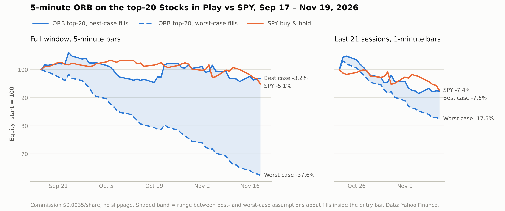

# Backtest: 5-minute Opening Range Breakout on "Stocks in Play"

Out-of-sample check of Zarattini, Barbon & Aziz, *A Profitable Day Trading Strategy For The U.S.
Equity Market* (Feb 2024, SSRN 4729284 / Swiss Finance Institute RP 24-98).

## What the paper claims

Over Jan 2016 – Dec 2023 on 7,000+ US stocks, a 5-minute ORB restricted to the 20 stocks with the
highest opening relative volume returned 1,600%+ net (about 41.6% a year vs about 15% for the
S&P 500), Sharpe 2.81, annualised alpha 36%. These figures come from the abstract and public
summaries; the PDF itself could not be downloaded in this environment.

## Rules implemented

| | |
|---|---|
| Universe | NASDAQ/NYSE/AMEX common stocks; open > $5, 14-day average volume >= 1M shares, 14-day ATR > $0.50 |
| Signal | first 5-minute bar up -> long only; down -> short only; doji -> no trade |
| Entry | stop order at the opening-range high (long) or low (short) |
| Stop | 10% of the 14-day ATR from the entry price |
| Exit | stop, otherwise the close |
| Stocks in Play | opening-bar volume / its 14-session average >= 100%; trade the 20 highest each day |
| Sizing | risk 1% of equity per trade, position capped at 4x equity / 20 (the cap almost always binds) |
| Costs | $0.0035 per share commission; slippage tested separately |

The sizing rule and commission are from memory of the paper and secondary sources, not verified
against the PDF. Per-trade results (R-multiples, basis points) do not depend on them.

## Data

Yahoo Finance: 5-minute bars for 60 sessions (the maximum Yahoo serves), of which 14 are warm-up,
leaving **46 trading days, 17 Sep – 19 Nov 2026**; 1,699 stocks pass the screen on at least one
day (58,109 candidate stock-days). 1-minute bars exist only for the last ~30 days, so the
selected trades of the **last 21 sessions** were re-run minute by minute.

## Results



Bar data cannot say whether a bar's adverse extreme came before or after the entry fill, so every
number is given as a range: *best case* (stopped on the entry bar only if it closes beyond the
stop) to *worst case* (stopped whenever the entry bar's range touches the stop).

| Top-20 portfolio, commission only | Total return | Hit rate | Avg per trade | t-stat (daily) |
|---|---|---|---|---|
| 46 days, 5-min bars, best case | -3.2% | 13.3% | +0.02R / -1.8 bps | -0.3 |
| 46 days, 5-min bars, worst case | -37.6% | 5.4% | -0.71R / -32 bps | -7.8 |
| last 21 days, 1-min bars, best case | -7.6% | 10.3% | -0.32R / -12 bps | -1.0 |
| last 21 days, 1-min bars, worst case | -17.5% | 6.3% | -0.68R / -30 bps | -3.6 |
| SPY buy & hold, 46 days | -5.1% | | | |

735 trades over 46 days (319 in the 1-minute rerun); average gross leverage 3.2x; beta to SPY
about -0.3.

Findings:

1. **No edge in this window, even on the most generous assumptions.** The best-case number on
   5-minute bars is roughly break-even before slippage; on 1-minute bars the best case is a loss.
2. **The result is decided inside the entry bar.** The median stop is 38 bps of price, while the
   opening range is 6.6x the stop distance. On the same 21 days the best case reads +0.9% on
   5-minute bars and -7.6% on 1-minute bars: coarser bars flatter the strategy.
3. **Slippage is fatal at this stop width.** One cent per share on the entry and on stop-outs costs
   about 0.14R per trade and turns the 46-day best case from -3.2% into -11.5%; 5 bps makes it -15.4%.
4. **Relative-volume ranking did not help.** Twenty randomly chosen screened breakouts per day
   beat the top-20 pick in 93% of 300 draws (best case). Across all 48,474 breakouts, per-trade
   results improve with relative volume up to about 3-5x and then collapse above 5x, which is
   where the top-20 picks sit (median relative volume 8x).
5. **The breakout direction itself had no follow-through.** With no stop at all, entering at the
   breakout and holding to the close lost 14 bps per trade (hit rate 49.5%). Wider stops
   (25%-100% of ATR) also lost money under both fill assumptions.

## Limits of this test

* 46 days cannot confirm or refute an 8-year result. At the paper's Sharpe of 2.8 the expected
  daily t-statistic over 46 days is only about +1.2; the best-case result here is about 1.5
  standard errors below that. It is one regime (SPY fell 5%).
* Yahoo intraday data is unaudited consolidated-tape data and may contain bad prints; it is
  self-consistent (1-minute and 5-minute opening ranges match on every selected trade).
* Listings are today's, so there is a small survivorship bias over a 2-month window.
* Fills are bounded, not known. Tick data would be needed to narrow the range further.

A multi-year replication needs a paid or keyed intraday source (e.g. Alpaca or Polygon); the code
only needs `download.py` swapped out.

## Reproduce

```
pip install -r requirements.txt
python download.py symbols && python download.py daily
python backtest.py screen && python download.py intraday
python backtest.py trades && python analyze.py select
python download.py m1 && python analyze.py report && python chart.py
```

Outputs land in `results/`: `summary.json` (all statistics), `trades_top20.csv`,
`trades_top20_1min.csv`, `equity_curves.csv`, `equity.png`.
